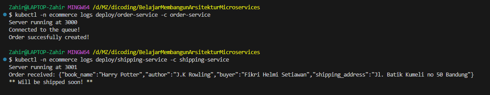

# E-Commerce App (Order Service + Shipping Service + RabbitMQ)

Branch `proyek-akhir` berisi `order-service/` dan `shipping-service/` (dari branch starter
`order-service` dan `shipping-service`), Dockerfile, `docker-compose.yml`, dan direktori `kubernetes/`.

## Build & push image ke GitHub Packages
```
echo $GHCR_TOKEN | docker login ghcr.io -u MyLovelyZ --password-stdin
docker build -t ghcr.io/mylovelyz/order-service:latest ./order-service
docker build -t ghcr.io/mylovelyz/shipping-service:latest ./shipping-service
docker push ghcr.io/mylovelyz/order-service:latest
docker push ghcr.io/mylovelyz/shipping-service:latest
```

## Docker Compose
```
docker compose up -d
docker compose logs -f shipping-service
```

## Kubernetes + Istio (RabbitMQ via StatefulSet, tanpa Helm/Operator)
```
istioctl install --set profile=demo -y
kubectl apply -f kubernetes/00-namespace.yaml
kubectl apply -f kubernetes/10-rabbitmq.yaml
kubectl -n ecommerce rollout status statefulset/rabbitmq
kubectl apply -f kubernetes/20-order-service.yaml -f kubernetes/30-shipping-service.yaml
kubectl apply -f kubernetes/40-istio-gateway.yaml
minikube tunnel   # terminal terpisah
```

## Uji coba
```
curl -X POST http://localhost:3000/order -H "Content-Type: application/json" \
 -d '{"order":{"book_name":"Harry Potter","author":"J.K Rowling","buyer":"Fikri Helmi Setiawan","shipping_address":"Jl. Batik Kumeli no 50 Bandung"}}'
```
(Pada Istio gunakan alamat `INGRESS` dari `kubectl -n istio-system get svc istio-ingressgateway` dengan path `/order`.)

## Bukti service berjalan (Kubernetes + Istio)

